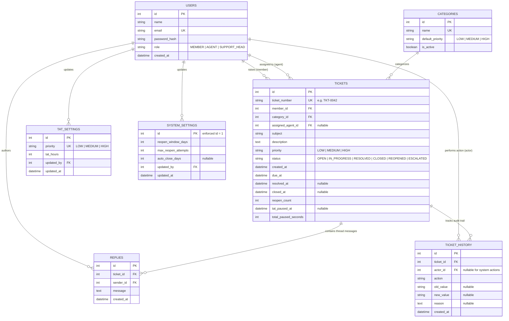
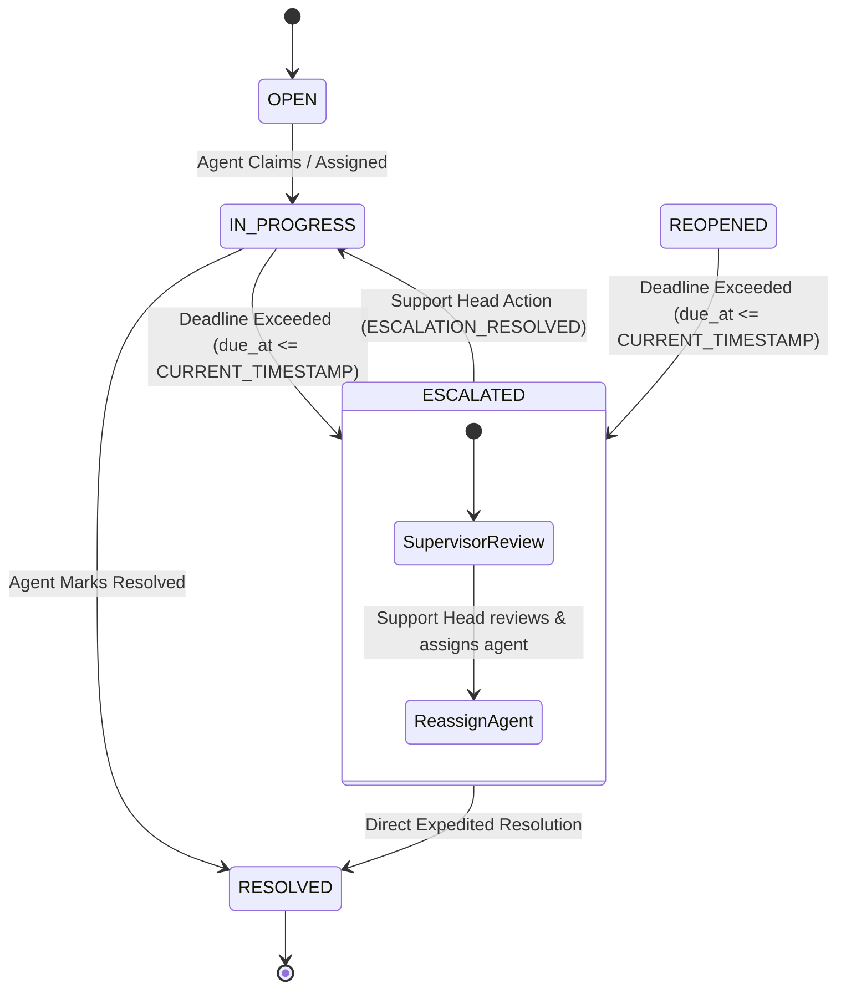

# Concave Support Ticketing System — Database Design & Entity Relationship Document (ERD)

## 1. Overview & Architectural Principles

The Concave Support Ticketing System database is engineered to provide high data integrity, strict auditability, deterministic SLA computation, and rapid query performance for real-time ticket queues and administrative dashboards.

### Core Database Principles:
- **Relational Integrity**: Strict foreign key constraints with indexed lookup keys across seven core entities.
- **Audit Immutability**: All lifecycle transitions, priority changes, reassignment actions, and automatic system escalations write append-only records to `TICKET_HISTORY`, protected by database engine triggers.
- **SLA Precision**: First-class tracking of turnaround times (`due_at`, `tat_paused_at`, `total_paused_seconds`) supporting continuous 24/7 SLA monitoring without time drift.
- **Lightweight & Portable**: Structured specifically for SQLite and mapped via SQLAlchemy ORM, ensuring seamless local development, testing, and clean forward migration to PostgreSQL.

---

## 2. Entity Relationship Diagram (Mermaid ERD)



---

## 3. Detailed Table Specifications & Schema Definitions

### 3.1 `USERS` Table
Stores participant identities, support personnel, and administrative supervisors.

| Column Name | Data Type | Nullable | Constraints & Defaults | Description |
| :--- | :--- | :---: | :--- | :--- |
| `id` | `INTEGER` | No | `PRIMARY KEY AUTOINCREMENT` | Unique internal user identifier. |
| `name` | `VARCHAR(100)` | No | None | Full legal or display name of the user. |
| `email` | `VARCHAR(255)` | No | `UNIQUE`, Indexed | Unique login email address. |
| `password_hash` | `VARCHAR(255)` | No | None | Securely salted password hash. |
| `role` | `VARCHAR(20)` | No | Check `('MEMBER', 'AGENT', 'SUPPORT_HEAD')` | Role for permission gating. |
| `created_at` | `DATETIME` | No | Default `CURRENT_TIMESTAMP` | UTC timestamp of account creation. |

---

### 3.2 `CATEGORIES` Table
Categorizes research participant inquiries and maps each to a default operational SLA priority.

| Column Name | Data Type | Nullable | Constraints & Defaults | Description |
| :--- | :--- | :---: | :--- | :--- |
| `id` | `INTEGER` | No | `PRIMARY KEY AUTOINCREMENT` | Unique category identifier. |
| `name` | `VARCHAR(100)` | No | `UNIQUE` | Distinct category name (e.g., Payment, Survey Issue). |
| `default_priority`| `VARCHAR(20)` | No | Check `('LOW', 'MEDIUM', 'HIGH')` | Default ticket priority automatically assigned upon selection. |
| `is_active` | `BOOLEAN` | No | Default `TRUE` | Soft toggle allowing categories to be retired without breaking legacy tickets. |

**Initial System Seed Data**:
1. *Payment* $\rightarrow$ Default: `HIGH`
2. *Survey Issue* $\rightarrow$ Default: `HIGH`
3. *Profile Change* $\rightarrow$ Default: `MEDIUM`
4. *Eligibility* $\rightarrow$ Default: `MEDIUM`
5. *Other* $\rightarrow$ Default: `LOW`

---

### 3.3 `TICKETS` Table
The central operational entity recording individual support queries, assignment state, lifecycle status, and precision SLA tracking.

| Column Name | Data Type | Nullable | Constraints & Defaults | Description |
| :--- | :--- | :---: | :--- | :--- |
| `id` | `INTEGER` | No | `PRIMARY KEY AUTOINCREMENT` | Internal primary key. |
| `ticket_number` | `VARCHAR(32)` | No | `UNIQUE`, Indexed | Human-readable unique identifier (e.g., `TKT-0042`). |
| `member_id` | `INTEGER` | No | `FOREIGN KEY (USERS.id)` | Identifier of the research member who raised the ticket. |
| `category_id` | `INTEGER` | No | `FOREIGN KEY (CATEGORIES.id)` | Foreign key referencing inquiry category. |
| `assigned_agent_id`| `INTEGER` | Yes | `FOREIGN KEY (USERS.id)`, Indexed | Assigned support agent (`NULL` if unassigned in queue). |
| `subject` | `VARCHAR(150)` | No | None | Concise summary of the participant's problem. |
| `description` | `TEXT` | No | None | Comprehensive details submitted by the member. |
| `priority` | `VARCHAR(20)` | No | Check `('LOW', 'MEDIUM', 'HIGH')` | Operational priority dictating SLA deadline. |
| `status` | `VARCHAR(20)` | No | Check `('OPEN', 'IN_PROGRESS', 'RESOLVED', 'CLOSED', 'REOPENED', 'ESCALATED')` | Current lifecycle state. |
| `created_at` | `DATETIME` | No | Default `CURRENT_TIMESTAMP` | UTC timestamp of ticket submission. |
| `due_at` | `DATETIME` | No | Indexed | Absolute UTC deadline before ticket is considered overdue/escalated. |
| `resolved_at` | `DATETIME` | Yes | Default `NULL` | UTC timestamp when agent marks ticket as `RESOLVED`. |
| `closed_at` | `DATETIME` | Yes | Default `NULL` | UTC timestamp when member confirms resolution or auto-closed. |
| `reopen_count` | `INTEGER` | No | Default `0`, Check `reopen_count >= 0` | Counter tracking number of times ticket has been reopened. |
| `tat_paused_at` | `DATETIME` | Yes | Default `NULL` | Timestamp when agent set ticket to "Waiting for Member". `NULL` when active. |
| `total_paused_seconds`| `INTEGER` | No | Default `0`, Check `total_paused_seconds >= 0` | Cumulative total seconds this ticket has spent in paused state. |

---

### 3.4 `REPLIES` Table
Houses the chronological conversation thread between members and support personnel.

| Column Name | Data Type | Nullable | Constraints & Defaults | Description |
| :--- | :--- | :---: | :--- | :--- |
| `id` | `INTEGER` | No | `PRIMARY KEY AUTOINCREMENT` | Unique reply identifier. |
| `ticket_id` | `INTEGER` | No | `FOREIGN KEY (TICKETS.id)`, Indexed | Target ticket associated with the message. |
| `sender_id` | `INTEGER` | No | `FOREIGN KEY (USERS.id)` | User who authored the response (Member, Agent, or Admin). |
| `message` | `TEXT` | No | None | Content of the message. |
| `created_at` | `DATETIME` | No | Default `CURRENT_TIMESTAMP` | UTC timestamp of comment posting. |

---

### 3.5 `TICKET_HISTORY` Table
An append-only immutable audit trail capturing every state change, assignment, priority adjustment, and system escalation.

| Column Name | Data Type | Nullable | Constraints & Defaults | Description |
| :--- | :--- | :---: | :--- | :--- |
| `id` | `INTEGER` | No | `PRIMARY KEY AUTOINCREMENT` | Unique history log identifier. |
| `ticket_id` | `INTEGER` | No | `FOREIGN KEY (TICKETS.id)`, Indexed | Ticket undergoing mutation. |
| `actor_id` | `INTEGER` | Yes | `FOREIGN KEY (USERS.id)` | User who triggered the action. **`NULL` specifically designates automated system actions** (e.g. Automatic Escalation, Auto-Close). |
| `action` | `VARCHAR(50)` | No | None | Standardized event key: `CREATED`, `ASSIGNED`, `PRIORITY_CHANGE`, `TAT_PAUSE`, `TAT_RESUME`, `STATUS_CHANGE`, `ESCALATED`, `ESCALATION_RESOLVED`, `REOPENED`, `RESOLVED`, `CLOSED`. |
| `old_value` | `VARCHAR(255)` | Yes | Default `NULL` | Previous attribute value before change. |
| `new_value` | `VARCHAR(255)` | Yes | Default `NULL` | New attribute value after change. |
| `reason` | `TEXT` | Yes | Default `NULL` | Mandatory contextual rationale for critical human actions and recorded system reasons for automated events. |
| `created_at` | `DATETIME` | No | Default `CURRENT_TIMESTAMP` | Precise UTC event timestamp. |

---

### 3.6 `TAT_SETTINGS` Table
Stores organizational Turnaround Time (TAT) duration policies mapped to priorities. Configurable exclusively by Support Head / Admin.

| Column Name | Data Type | Nullable | Constraints & Defaults | Description |
| :--- | :--- | :---: | :--- | :--- |
| `id` | `INTEGER` | No | `PRIMARY KEY AUTOINCREMENT` | Unique setting record ID. |
| `priority` | `VARCHAR(20)` | No | `UNIQUE`, Check `('LOW', 'MEDIUM', 'HIGH')` | Target priority level. |
| `tat_hours` | `INTEGER` | No | Check `tat_hours > 0` | Target turnaround SLA in continuous hours. |
| `updated_by` | `INTEGER` | No | `FOREIGN KEY (USERS.id)` | Admin user ID who last updated the SLA. |
| `updated_at` | `DATETIME` | No | Default `CURRENT_TIMESTAMP` | UTC timestamp of last policy adjustment. |

**Default Seed Data**:
- `HIGH` $\rightarrow$ `4` hours
- `MEDIUM` $\rightarrow$ `24` hours
- `LOW` $\rightarrow$ `48` hours

---

### 3.7 `SYSTEM_SETTINGS` Table
Singleton configuration table controlling global support policies, re-opening parameters, and automated lifecycle closures.

| Column Name | Data Type | Nullable | Constraints & Defaults | Description |
| :--- | :--- | :---: | :--- | :--- |
| `id` | `INTEGER` | No | `PRIMARY KEY CHECK (id = 1)` | Singleton identifier locked strictly to row 1. |
| `reopen_window_days` | `INTEGER` | No | Default `7`, Check `reopen_window_days > 0` | Maximum days after resolution that a member may reopen a ticket. |
| `max_reopen_attempts`| `INTEGER` | No | Default `2`, Check `max_reopen_attempts >= 0` | Maximum lifetime reopen events allowed per ticket. |
| `auto_close_days` | `INTEGER` | Yes | Default `7`, Check `auto_close_days > 0` | Days after resolution before ticket automatically transitions to `CLOSED`. |
| `updated_by` | `INTEGER` | No | `FOREIGN KEY (USERS.id)` | Admin user ID who last updated these parameters. |
| `updated_at` | `DATETIME` | No | Default `CURRENT_TIMESTAMP` | UTC timestamp of last update. |

#### Singleton Enforcement Mechanics:
The `SYSTEM_SETTINGS` table is restricted to exactly one row representing active system policies:
1. **Database Constraint**: `id INTEGER PRIMARY KEY CHECK (id = 1)`. Any SQL `INSERT` attempting to create a second record (`id = 2`) is rejected at the database engine level with a check constraint failure.
2. **Application / ORM Pattern**: The service layer exposes a singleton repository method `get_settings()` that always queries `WHERE id = 1`. Administrative modifications issue `UPDATE SYSTEM_SETTINGS SET ... WHERE id = 1`, and initial application migrations seed the row using `INSERT OR IGNORE INTO SYSTEM_SETTINGS (id, ...) VALUES (1, ...)`.

---

## 4. Key Relationships & Cardinality

1. **User $\rightarrow$ Tickets (Member)** (`1 : N`):
   - A single member can submit multiple tickets over time.
   - Each ticket belongs strictly to exactly one `member_id`.
2. **User $\rightarrow$ Tickets (Assigned Agent)** (`1 : N`):
   - A support agent can have many tickets assigned to them in parallel.
   - A ticket can either have zero assigned agents (`assigned_agent_id IS NULL` when unassigned in queue) or exactly one assigned agent.
3. **Category $\rightarrow$ Tickets** (`1 : N`):
   - A category groups multiple tickets.
   - Each ticket is mapped to exactly one category.
4. **Ticket $\rightarrow$ Replies** (`1 : N`):
   - A ticket contains an ordered thread of zero or more replies.
   - Thread entries are ordered chronologically by `created_at ASC`.
5. **Ticket $\rightarrow$ Ticket History** (`1 : N`):
   - Every single mutation on a ticket generates a new immutable history record.
   - Forms an append-only audit trail of the ticket's lifecycle.
6. **User $\rightarrow$ Ticket History (Actor)** (`0/1 : N`):
   - An actor is a registered user (`AGENT`, `MEMBER`, or `SUPPORT_HEAD`).
   - For system-initiated actions (automatic deadline escalation, auto-close), `actor_id` is stored as `NULL`.
7. **User $\rightarrow$ TAT Settings & System Settings** (`1 : N`):
   - Enforces administrative accountability by tracking which Support Head configured the SLA parameters.

---

## 5. Critical Database Constraints & Indexes

### 5.1 Indexes for Query Optimization
To ensure the Agent Support Queue and Executive Dashboard render instantaneously without table scans, the following composite and single-column indexes are defined:

1. `idx_tickets_status_due_at`: `ON TICKETS(status, due_at)`
   - Accelerates the background escalation worker and overdue ticket filtering (`due_at <= CURRENT_TIMESTAMP`).
2. `idx_tickets_assigned_agent`: `ON TICKETS(assigned_agent_id, status)`
   - Optimizes personal queue filtering for individual support agents ("My Assigned Tickets").
3. `idx_tickets_member_created`: `ON TICKETS(member_id, created_at DESC)`
   - Enables fast pagination for member dashboard views.
4. `idx_replies_ticket_created`: `ON REPLIES(ticket_id, created_at ASC)`
   - Guarantees sequential rendering of conversation threads.
5. `idx_history_ticket_created`: `ON TICKET_HISTORY(ticket_id, created_at ASC)`
   - Enables instant chronological assembly of ticket audit logs.

### 5.2 Integrity Constraints and Validation Division
- `CHECK(priority IN ('LOW', 'MEDIUM', 'HIGH'))`
- `CHECK(status IN ('OPEN', 'IN_PROGRESS', 'RESOLVED', 'CLOSED', 'REOPENED', 'ESCALATED'))`
- `CHECK(reopen_count >= 0)`
- `CHECK(total_paused_seconds >= 0)`
- `CHECK(tat_hours > 0)` in `TAT_SETTINGS`
- `CHECK(id = 1)` in `SYSTEM_SETTINGS`

> [!IMPORTANT]
> **Enforcement of Dynamic Reopen Limits**:
> In SQL, table `CHECK` constraints cannot execute subqueries or evaluate columns across tables. Therefore, `reopen_count` is constrained at the table level with `CHECK(reopen_count >= 0)`. The maximum reopening threshold is dynamically configured in `SYSTEM_SETTINGS.max_reopen_attempts` (default: 2) and strictly enforced at the backend validation / API layer before any status transition to `REOPENED` is committed.

---

## 6. Audit Trail & Ticket History Architecture

### 6.1 Why Auditability Matters in Market Research Support
Concave Insights operates under strict participant compliance standards. If a participant claims their survey incentive was not paid within the 15-day research cycle, or an agent deprioritized a ticket improperly, management requires an incontrovertible, tamper-evident audit record.

### 6.2 Protection Against Updates and Deletes (Immutability Enforcement)
The `TICKET_HISTORY` table represents an immutable append-only ledger. To guarantee that audit records cannot be altered or purged after creation:
1. **Application / ORM Layer**: The SQLAlchemy repository layer exposes strictly `append()` and `query()` interfaces for `TicketHistory`. No `update()` or `delete()` routes exist in the codebase.
2. **Database Engine Triggers**: SQLite database triggers reject any SQL `UPDATE` or `DELETE` operations on `TICKET_HISTORY`:

```sql
-- Prevent updates to ticket audit records
CREATE TRIGGER trg_ticket_history_no_update
BEFORE UPDATE ON TICKET_HISTORY
BEGIN
    SELECT RAISE(ABORT, 'TICKET_HISTORY is an immutable audit log: updates are strictly prohibited.');
END;

-- Prevent deletes from ticket audit records
CREATE TRIGGER trg_ticket_history_no_delete
BEFORE DELETE ON TICKET_HISTORY
BEGIN
    SELECT RAISE(ABORT, 'TICKET_HISTORY is an immutable audit log: deletions are strictly prohibited.');
END;
```

### 6.3 Atomic Audit Logging Workflow
Every state-modifying API endpoint wraps the entity update and history entry in a single atomic database transaction:

```sql
BEGIN TRANSACTION;
  UPDATE TICKETS 
  SET priority = 'HIGH' 
  WHERE id = 42;

  INSERT INTO TICKET_HISTORY (
    ticket_id, actor_id, action, old_value, new_value, reason, created_at
  ) VALUES (
    42, 5, 'PRIORITY_CHANGE', 'MEDIUM', 'HIGH', 
    'Participant survey cycle expiring in 24 hours', CURRENT_TIMESTAMP
  );
COMMIT;
```

### 6.4 Standardized Action Types Logged in `TICKET_HISTORY`
- `CREATED`: Initial ticket creation with category, priority, and computed `due_at`.
- `ASSIGNED`: Ticket claimed by or assigned to an agent (`old_value` $\rightarrow$ `new_value`).
- `PRIORITY_CHANGE`: Modification of priority with mandatory human reason and recalculated `due_at`.
- `TAT_PAUSE`: Ticket transitioned to "Waiting for Member", SLA clock paused (`tat_paused_at` recorded).
- `TAT_RESUME`: Member reply received, SLA deadline extended, clock resumed (`tat_paused_at` cleared).
- `STATUS_CHANGE`: Generic status movement (e.g., `OPEN` $\rightarrow$ `IN_PROGRESS`).
- `ESCALATED`: Background daemon triggers SLA breach (`actor_id = NULL`, system reason recorded).
- `ESCALATION_RESOLVED`: Support Head reviews and returns escalated ticket to active agent handling (`actor_id = head_id`, supervisory reason recorded).
- `RESOLVED`: Agent marks issue resolved with resolution summary.
- `REOPENED`: Member reopens within 7 days with mandatory explanation (`reopen_count` incremented).
- `CLOSED`: Member confirms resolution or system auto-closes after inactivity period (`actor_id = NULL` for auto-close).

---

## 7. Turnaround Time (TAT) Calculations, Pausing, and Escalation

### 7.1 Continuous 24/7 TAT Calculation
Unlike standard business-hours SLAs, Concave Insights' 15-day research sprints operate continuously:
- **Rule**: SLA timer runs 24 hours per day, 7 days per week, including weekends and public holidays.
- **Formula**:
  $$\text{due\_at} = \text{created\_at} + \text{tat\_hours}(\text{priority})$$
- *Example*: A High-priority ticket submitted at 11:00 PM on a Saturday has a 4-hour SLA. Its `due_at` is precisely 3:00 AM on Sunday.

### 7.2 The "Waiting for Member" TAT Pause Mechanism
When an inquiry cannot progress without participant input (e.g., verifying UPI transaction ID, bank IFSC code, or survey screenshot), penalizing the support agent's resolution metrics is unjust. The system uses a stateful pause mechanism:

1. **Pause Trigger**:
   - Agent selects "Waiting for Member" when posting a reply.
   - Database updates:
     - `TICKETS.tat_paused_at = CURRENT_TIMESTAMP`
     - Inserts record into `TICKET_HISTORY` with action `TAT_PAUSE`.
2. **State During Pause**:
   - The escalation background job ignores tickets where `tat_paused_at IS NOT NULL`.
   - UI displays a "Clock Paused" badge with active countdown frozen.
3. **Resume Trigger**:
   - As soon as the member submits any reply to the ticket thread:
   - System calculates actual pause duration:
     $$\Delta t = \text{CURRENT\_TIMESTAMP} - \text{TICKETS.tat\_paused\_at}$$
   - System updates the ticket:
     $$\text{TICKETS.total\_paused\_seconds} \leftarrow \text{TICKETS.total\_paused\_seconds} + \Delta t$$
     $$\text{TICKETS.due\_at} \leftarrow \text{TICKETS.due\_at} + \Delta t$$
     $$\text{TICKETS.tat\_paused\_at} \leftarrow \text{NULL}$$
   - Inserts record into `TICKET_HISTORY` with action `TAT_RESUME`.

### 7.3 Priority Change and Active-Time SLA Recalculation
When an agent modifies the priority of an active ticket (with mandatory reason), the system dynamically recalculates `due_at` while preserving the exact active time consumed before the change.

#### A. Active Elapsed Time Calculation
1. **If the ticket is NOT currently paused** (`tat_paused_at IS NULL`):
   $$\text{active\_elapsed} = (\text{CURRENT\_TIMESTAMP} - \text{created\_at}) - \text{total\_paused\_seconds}$$
2. **If the ticket IS currently paused** (`tat_paused_at IS NOT NULL`):
   $$\text{active\_elapsed} = (\text{tat\_paused\_at} - \text{created\_at}) - \text{total\_paused\_seconds}$$

#### B. Remaining SLA and Deadline Calculation
Retrieve the new priority's total duration in seconds: $\text{new\_priority\_tat\_seconds}$.

$$\text{remaining\_sla} = \text{new\_priority\_tat\_seconds} - \text{active\_elapsed}$$

1. **For an unpaused ticket**:
   - If $\text{remaining\_sla} > 0$:
     $$\text{due\_at} = \text{CURRENT\_TIMESTAMP} + \text{remaining\_sla}$$
     The ticket continues in its active status with the updated deadline.
   - If $\text{remaining\_sla} \le 0$:
     The active time consumed already exceeds the new priority's total SLA. The ticket immediately breaches SLA:
     $$\text{due\_at} = \text{CURRENT\_TIMESTAMP} + \text{remaining\_sla} \quad (\text{a timestamp in the past})$$
     Status transitions to `ESCALATED`, logged in `TICKET_HISTORY` with actions `PRIORITY_CHANGE` and `ESCALATED`.
2. **For a currently paused ticket**:
   - Recalculate deadline based on active time consumed prior to pause:
     $$\text{due\_at} = \text{tat\_paused\_at} + \text{remaining\_sla}$$
   - Preserve existing `tat_paused_at` (do not count ongoing pause duration twice).
   - When the member eventually responds, resumption logic adds the actual elapsed pause duration exactly once ($\text{due\_at} \leftarrow \text{due\_at} + \Delta t$).
   - If $\text{remaining\_sla} \le 0$, the recalculated deadline is $\le \text{tat\_paused\_at}$; upon resumption, the ticket resumes immediately in overdue/`ESCALATED` status.

#### Numerical Example:
- Ticket created at 10:00 AM with `MEDIUM` priority (24h = 86,400s).
- At 1:00 PM (3 hours = 10,800s active), agent pauses ticket: `tat_paused_at = 1:00 PM`.
- At 2:00 PM, while still paused, agent reviews survey urgency and changes priority to `HIGH` (4h = 14,400s).
- Calculation:
  - $\text{active\_elapsed} = (\text{1:00 PM} - \text{10:00 AM}) - 0 = 3\text{ hours } (10,800\text{s})$.
  - $\text{remaining\_sla} = 14,400\text{s} - 10,800\text{s} = 3,600\text{s} (1\text{ hour})$.
  - $\text{due\_at} = \text{1:00 PM} + 1\text{ hour} = \text{2:00 PM}$.
- At 2:30 PM (pause duration $\Delta t = 90\text{ minutes}$), member replies:
  - Resumption adds pause duration: $\text{due\_at} = \text{2:00 PM} + 90\text{ min} = \text{3:30 PM}$.
  - The remaining 1 hour of SLA is preserved exactly from the resumption point.

### 7.4 Automatic Escalation & Returning Escalated Tickets to Active Agent Handling



#### 1. Automatic Escalation Detection
Every 60 seconds, a background worker executes the exact SQL query:
```sql
SELECT id, ticket_number, priority, due_at 
FROM TICKETS 
WHERE status NOT IN ('RESOLVED', 'CLOSED', 'ESCALATED')
  AND tat_paused_at IS NULL
  AND due_at <= CURRENT_TIMESTAMP;
```

For every matching overdue ticket:
- Status is updated to `ESCALATED`.
- Appends record to `TICKET_HISTORY`:
  - `actor_id`: `NULL` (System Agent).
  - `action`: `'ESCALATED'`.
  - `reason`: `'Resolution deadline exceeded active SLA threshold'`.
- Real-time in-app notification emitted to the Support Head.

#### 2. Returning Escalated Tickets to Active Agent Handling
An escalated ticket does not remain deadlocked. It is returned to active handling exclusively through the Support Head's intervention:
- **Supervisor Review**: Support Head accesses the Escalated Tickets Feed, examines why the deadline lapsed, and selects an agent (or specialist).
- **Preservation of Overdue Deadline**: Returning an escalated ticket to active handling **preserves its original overdue deadline**; it does not silently grant a fresh SLA. Any explicit SLA extension must be a distinct, separately audited administrative action.
- **State Transition**:
  $$\text{status: } \text{ESCALATED} \longrightarrow \text{IN\_PROGRESS}$$
- **Audit Record**: Logged in `TICKET_HISTORY` with:
  - `actor_id`: Support Head's user ID.
  - `action`: `'ESCALATION_RESOLVED'`.
  - `old_value`: `'ESCALATED'`.
  - `new_value`: `'IN_PROGRESS'`.
  - `reason`: Mandatory supervisory directive (e.g., `"Reassigned to Senior Agent for immediate disbursement clearance"`).
- **Notification**: Newly assigned agent receives priority alert and the ticket appears at the top of their active queue.
