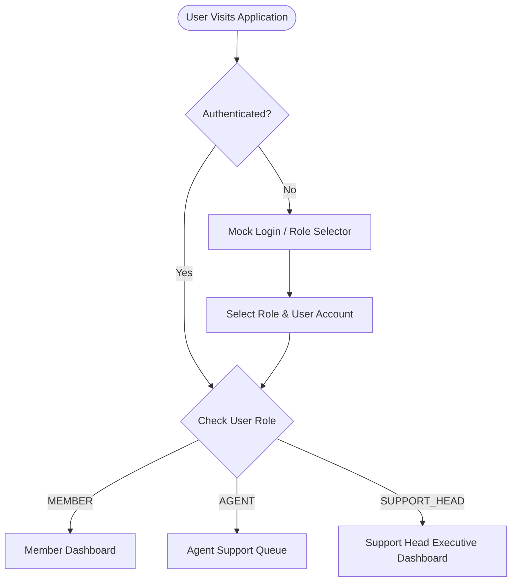
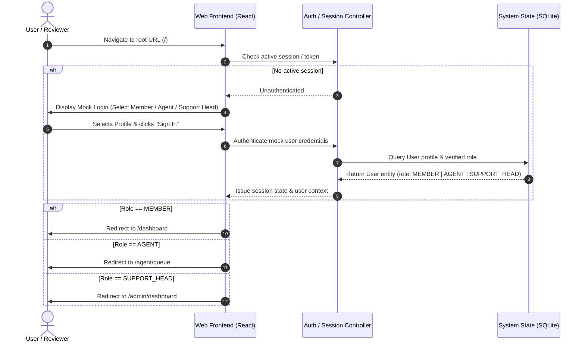
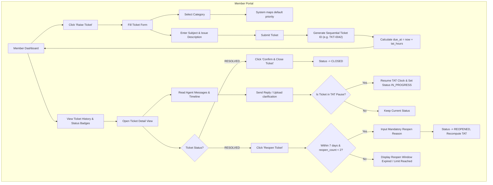
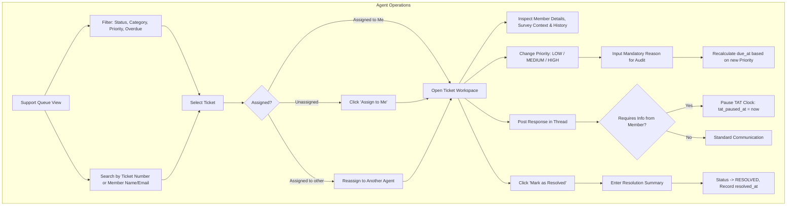
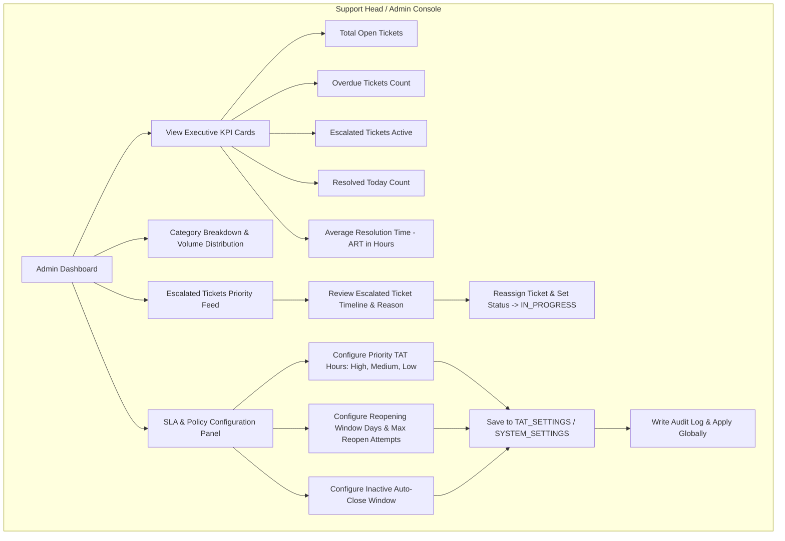
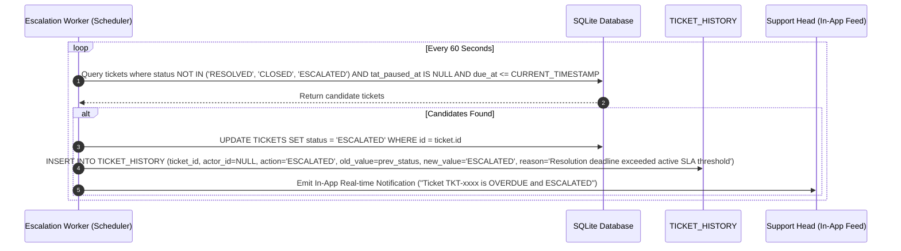
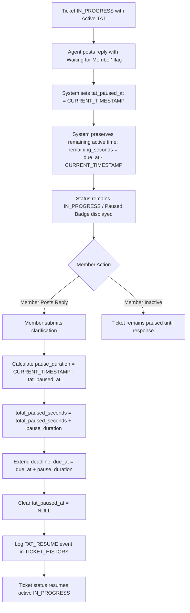

# Concave Support Ticketing System — User Flow & System Workflows

## 1. System Overview & Context

Concave Insights is a market research and consumer insights organization running structured research projects in strict 15-day cycles. Survey participants (members) who complete paid studies earn survey stipends and referral incentives. To protect research sample integrity, participants who complete one study enter a mandatory 3-month cooling-off window before participating in another study.

Previously, support queries were handled informally across phone calls and WhatsApp chats, causing dropped requests, zero SLA tracking, lack of audit trails, and missed resolution timelines. 

The **Concave Support Ticketing System** establishes a centralized, auditable, and automated web platform providing:
- Distinct role-based portals for **Members**, **Support Agents**, and **Support Head (Admin)**.
- Automated SLA tracking with 24/7 continuous Turnaround Time (TAT).
- Automatic escalation of overdue tickets directly to the Support Head.
- Stateful "Waiting-for-Member" TAT pausing and resumption.
- Controlled ticket resolution, re-opening windows, and immutable audit logs.



---

## 2. Authentication & Role-Based Routing (Mock Login)

The initial system utilizes a streamlined mock authentication mechanism enabling seamless role switching for demonstration, user acceptance testing, and workflow validation.

### 2.1 Role Access Matrix

| Role | Default Landing Page | Primary Permissions | Prohibited Actions |
| :--- | :--- | :--- | :--- |
| **MEMBER** | `/dashboard` (Member View) | Raise tickets, view personal tickets, reply on threads, confirm resolution (close), reopen resolved tickets within 7-day window. | View other members' tickets, alter ticket priority, assign tickets, view internal audit records. |
| **AGENT** | `/agent/queue` | View global ticket queue, filter & search, self-assign ordinary tickets, reassign ordinary tickets, respond, request info (pause TAT), change priority (with reason), resolve tickets. | Modify global TAT SLA settings, alter reopen policy, return escalated tickets to active handling, delete tickets, access member passwords. |
| **SUPPORT_HEAD** | `/admin/dashboard` | View company-wide SLA metrics, monitor escalated/overdue tickets, review and return escalated tickets to active handling, configure priority TAT hours, configure reopening rules. | N/A (Full supervisory and configuration access across all domains). |

### 2.2 Login & Redirection Workflow



---

## 3. Member Workflow

Members interact with Concave Support to resolve payment issues, survey link problems, profile corrections, or eligibility queries.



### 3.1 Step-by-Step Member Actions

1. **Dashboard Overview**:
   - Member views active tickets, resolved tickets, and total tickets raised.
   - Each ticket card displays: Ticket ID (e.g., `TKT-0042`), Category, Current Status Badge, Priority, Created Date, and Last Activity.
2. **Raising a New Ticket**:
   - Clicks **"Raise New Ticket"** modal/page.
   - **Category Selection**:
     - *Payment* (Incentive missing, referral bonus delay) $\rightarrow$ Default Priority: `HIGH`
     - *Survey Issue* (Broken link, mid-survey crash, screening fault) $\rightarrow$ Default Priority: `HIGH`
     - *Profile Change* (Bank details update, email/phone update) $\rightarrow$ Default Priority: `MEDIUM`
     - *Eligibility* (3-month cooling period inquiry, project criteria) $\rightarrow$ Default Priority: `MEDIUM`
     - *Other* (General inquiries) $\rightarrow$ Default Priority: `LOW`
   - **Description**: Member inputs subject line (min 5 characters) and comprehensive details (min 10 characters).
   - **Submission & ID Generation**: System assigns an atomic identifier (e.g., `TKT-0042`), calculates target `due_at` from the active `TAT_SETTINGS`, writes `TICKET_HISTORY`, and sets status to `OPEN`.
3. **Tracking & Messaging**:
   - Member views chronological conversation thread. Agent responses and system status transitions are timestamped.
   - Member can post reply comments. If the ticket was in a paused state awaiting input, posting immediately resumes the SLA clock.
4. **Resolution Acceptance, Reopening, and Auto-Closure**:
   - When an agent marks a ticket as `RESOLVED`, the resolution timestamp `resolved_at` is stamped.
   - **Path A: Manual Confirmation**: Member clicks **"Confirm Resolution"** $\rightarrow$ status changes to `CLOSED`, `closed_at` timestamp recorded.
   - **Path B: Reopening**: If the issue persists, member clicks **"Reopen Ticket"**.
     - *Eligibility Check*: The ticket must be currently in `RESOLVED` status, `now - resolved_at <= reopen_window_days` (default 7 days), and `reopen_count < max_reopen_attempts` (default 2).
     - *Validation*: Member must enter a mandatory reason (min 10 characters).
     - *State Mutation*: `reopen_count` increments by 1, status transitions to `REOPENED`, new `due_at` is recalculated, and `TICKET_HISTORY` logs the event.
   - **Path C: Automatic Closure**: If the member takes no action (neither confirming nor reopening) within `auto_close_days` (default 7 days of inactivity following `resolved_at`), the background scheduler transitions the ticket to `CLOSED`. Once `CLOSED`, reopening is permanently disabled.

---

## 4. Support Agent Workflow

Support Agents manage the incoming queue, investigate survey/payment discrepancies, interact with participants, adjust priority if warranted, and drive tickets to resolution.



### 4.1 Step-by-Step Agent Actions

1. **Queue Management & Filtering**:
   - Agents access `/agent/queue` with real-time indicators.
   - Filter criteria:
     - **Status**: `OPEN`, `IN_PROGRESS`, `ESCALATED`, `REOPENED`, `RESOLVED`, `CLOSED`.
     - **Category**: `Payment`, `Profile Change`, `Survey Issue`, `Eligibility`, `Other`.
     - **Priority**: `HIGH`, `MEDIUM`, `LOW`.
     - **Overdue Flag**: Toggle to isolate tickets where `due_at <= CURRENT_TIMESTAMP` and status not in (`RESOLVED`, `CLOSED`).
   - Search bar: Instant exact or prefix match on `TKT-xxxx`, member name, or email.
2. **Assignment & Permissions**:
   - Agents can claim unassigned ordinary tickets (`Assign to Me`).
   - Agents can reassign ordinary tickets to other agents when workload rebalancing is required.
   - **Crucial Permission Boundary**: Agents **cannot** return `ESCALATED` tickets to active handling; only the Support Head has permission to review and resolve escalations.
3. **Thread Interaction & Waiting-for-Member Action**:
   - Agent writes replies to the member.
   - If the agent requires the member to provide proof of survey completion, transaction screenshot, or KYC document, the agent selects the **"Request Member Info"** option.
   - This records `tat_paused_at` and initiates the **TAT pause** logic (detailed in Section 7).
4. **Priority Elevation / Demotion**:
   - Agents can alter ticket priority (e.g., from `MEDIUM` to `HIGH` if a payment dispute involves an expired survey cycle).
   - **Validation**: System enforces a mandatory text explanation. The action, old priority, new priority, and reason are logged in `TICKET_HISTORY`.
   - The ticket `due_at` deadline is dynamically recalculated while preserving consumed active time (supporting both paused and unpaused states).
5. **Resolution**:
   - When the agent verifies that the participant's stipend has been disbursed or survey error resolved, they click **"Resolve Ticket"**.
   - Agent enters a resolution note.
   - Status becomes `RESOLVED`, `resolved_at` is stamped, and the 7-day reopening window begins.

---

## 5. Support Head / Admin Workflow

The Support Head oversees operational SLAs, monitors escalations, tracks team performance, and configures organizational policies.



### 5.1 Dashboard Metrics & Real-time KPIs
1. **Total Open Tickets**: Aggregate volume of active non-resolved tickets (`OPEN`, `IN_PROGRESS`, `REOPENED`, `ESCALATED`).
2. **Overdue Tickets**: Tickets where `due_at <= CURRENT_TIMESTAMP` and status not in (`RESOLVED`, `CLOSED`).
3. **Escalated Tickets**: Tickets tagged with `status = ESCALATED` requiring supervisory intervention.
4. **Resolved Today**: Count of tickets transitioned to `RESOLVED` or `CLOSED` within the current calendar day (UTC).
5. **Average Resolution Time (ART)**:
   $$\text{ART} = \frac{\sum (\text{resolved\_at} - \text{created\_at} - \text{total\_paused\_seconds})}{N_{\text{resolved}}}$$
   - Calculated strictly across eligible resolved tickets within the dashboard reporting period (default: rolling 30 days).
   - Unresolved tickets (`OPEN`, `IN_PROGRESS`, `ESCALATED`, `REOPENED`) are excluded.
   - Calculation depends on `resolved_at`, so whether a resolved ticket has later moved to `CLOSED` does not alter its resolution duration.
   - Converted to hours for executive dashboard display.
6. **Category Breakdown**: Visual distribution of issues across categories.

### 5.2 System SLA & Policy Configuration
The Support Head possesses exclusive permissions to calibrate operational parameters without modifying codebase:
- **Priority Resolution Hours**:
  - `HIGH`: Default 4 hours.
  - `MEDIUM`: Default 24 hours.
  - `LOW`: Default 48 hours.
- **Ticket Reopen Parameters**:
  - `reopen_window_days`: Default 7 days.
  - `max_reopen_attempts`: Default 2 attempts.
- **Auto-Close Policy**:
  - `auto_close_days`: Default 7 days (automatically transition `RESOLVED` tickets to `CLOSED` after inactivity).

### 5.3 Escalated-Ticket Review and Reassignment Workflow

When a ticket breaches its resolution deadline and enters `ESCALATED` status, it appears prominently on the Support Head's Escalation Feed. Only the Support Head can return an escalated ticket to active handling:

```mermaid
sequenceDiagram
    autonumber
    actor Head as Support Head
    participant UI as Admin Dashboard (/admin/dashboard)
    participant API as Ticket Controller
    participant DB as SQLite Database
    participant History as TICKET_HISTORY
    actor Agent as Assigned Agent

    Head->>UI: Opens "Escalated Tickets" Feed
    UI->>Head: Displays overdue tickets (due_at <= now) with breach duration
    Head->>UI: Clicks "Review & Reassign" on TKT-0042
    UI->>Head: Shows full ticket timeline, member details, and audit history
    Head->>UI: Selects designated agent & enters supervisory directive reason
    Head->>UI: Clicks "Reassign & Resume Ticket"
    UI->>API: POST /api/tickets/TKT-0042/reassign-escalated {new_agent_id, directive_reason}
    API->>DB: UPDATE TICKETS SET assigned_agent_id = new_agent_id, status = 'IN_PROGRESS' WHERE id = ticket.id
    API->>History: INSERT INTO TICKET_HISTORY (ticket_id, actor_id=head_id, action='ESCALATION_RESOLVED', old_value='ESCALATED', new_value='IN_PROGRESS', reason=directive_reason)
    API-->>UI: Success confirmation
    UI->>Head: Ticket removed from Escalated Feed; metric updated
    API->>Agent: Emits priority notification with supervisor directive
```

#### Reassignment & Return to Active Handling Rules:
1. **Preservation of Overdue Deadline**: Returning an escalated ticket to active handling **preserves its original overdue deadline**. It does not silently grant a fresh SLA. Any explicit SLA extension must be separately recorded and audited as an administrative exception.
2. **Supervisor Reason Required**: Support Head must enter a mandatory directive explaining the corrective path forward.
3. **Audit Logged**: Recorded with `action = 'ESCALATION_RESOLVED'`, `actor_id = head_id`, and `reason` in `TICKET_HISTORY`.
4. **Agent Notification**: The assigned agent is alerted immediately to expedite resolution.

---

## 6. Automatic Escalation Workflow

The automatic escalation engine runs as a periodic daemon/scheduler checking active tickets against their deadlines.



### 6.1 Escalation Rules & Mechanics
1. **Trigger Condition**: A ticket whose status is `OPEN`, `IN_PROGRESS`, or `REOPENED`, where `tat_paused_at IS NULL`, and `due_at <= CURRENT_TIMESTAMP`.
2. **Exclusion Criteria**:
   - Tickets in `RESOLVED` or `CLOSED` status are never escalated.
   - Tickets already in `ESCALATED` status are excluded to prevent repeated duplicate escalations.
   - Tickets currently paused (`tat_paused_at IS NOT NULL`) are excluded from automatic escalation while awaiting member response.
3. **State Transition**: Status changes to `ESCALATED`.
4. **Audit Immutability**: A system-level history record is written with `actor_id = NULL` (indicating automated system execution), action `ESCALATED`, and reason: `"Resolution deadline exceeded active SLA threshold"`.
5. **Supervisory Alert**: The ticket appears prominently at the top of the Support Head's Escalation Dashboard.

---

## 7. "Waiting-for-Member" TAT Pausing & Resumption Workflow

In market research support, tickets often stall because the participant has not provided their payment transaction identifier, registered phone number, or survey error screenshot. To prevent unfair SLA breaches on agent-dependent metrics, the system implements precision TAT pausing.



### 7.1 Mathematical Precision of TAT Preservation

Let:
- $T_{\text{created}}$: Time of ticket creation.
- $T_{\text{due}}^{\text{original}}$: Initial deadline calculated as $T_{\text{created}} + \text{TAT}_{\text{priority}}$.
- $T_{\text{pause}}$: Timestamp when agent toggles waiting state (`tat_paused_at`).
- $R_{\text{remaining}} = T_{\text{due}}^{\text{original}} - T_{\text{pause}}$: Active time remaining before SLA breach.
- $T_{\text{resume}}$: Timestamp when member submits response.
- $\Delta T_{\text{paused}} = T_{\text{resume}} - T_{\text{pause}}$: Elapsed pause duration.

Upon resumption:
1. System adds actual pause duration:
   $$\text{total\_paused\_seconds} \leftarrow \text{total\_paused\_seconds} + \Delta T_{\text{paused}}$$
2. System extends deadline by exactly the pause duration:
   $$T_{\text{due}}^{\text{new}} \leftarrow T_{\text{due}}^{\text{previous}} + \Delta T_{\text{paused}} \equiv T_{\text{resume}} + R_{\text{remaining}}$$
3. System clears pause marker:
   $$\text{tat\_paused\_at} \leftarrow \text{NULL}$$
4. System appends audit record with action `TAT_RESUME`.

This guarantees that the exact number of seconds remaining on the resolution SLA is preserved down to the second, preventing false escalations while fairly accommodating participant response delays.

### 7.2 Handling Pausing When a Ticket is Already Overdue
An important edge case occurs if an agent requests information on a ticket that has already breached its resolution deadline ($T_{\text{pause}} > T_{\text{due}}$, meaning $R_{\text{remaining}} \le 0$):
- **Clock Freezing**: The system allows the agent to flag "Waiting for Member", setting `tat_paused_at = CURRENT_TIMESTAMP`. While paused, the ticket stops accumulating further active overdue time against the agent.
- **Resumption Behavior**: When the member eventually replies, the system extends `total_paused_seconds` by the pause duration. However, because $R_{\text{remaining}} \le 0$, **no additional resolution time is granted**.
- **Outcome**: The ticket resumes immediately in overdue status (`due_at <= CURRENT_TIMESTAMP`), triggering immediate escalation if not already escalated. Pausing cannot be used to erase or reset an already breached SLA deadline.

---

## 8. Role Permissions Matrix

| Feature / Action | Member | Support Agent | Support Head / Admin |
| :--- | :---: | :---: | :---: |
| **Raise New Ticket** | Yes | Yes (on behalf) | Yes |
| **View Own Tickets** | Yes | Yes | Yes |
| **View Full Queue / All Tickets** | No | Yes | Yes |
| **Filter & Search Queue** | No | Yes | Yes |
| **Assign / Reassign Ordinary Ticket** | No | Yes | Yes |
| **Post Message in Thread** | Yes (own tickets) | Yes (assigned) | Yes (all tickets) |
| **Trigger "Waiting for Member" (Pause TAT)** | No | Yes | Yes |
| **Change Priority (Mandatory Reason)** | No | Yes | Yes |
| **Mark Ticket Resolved** | No | Yes | Yes |
| **Confirm Resolution (Close Ticket)** | Yes (own tickets) | Yes | Yes |
| **Reopen Ticket (within 7 days & $<2$ attempts)** | Yes (own tickets) | No (Agents resolve) | Yes |
| **Review & Return Escalated Tickets to Active** | No | No | Yes |
| **Configure Global SLA TAT Settings** | No | No | Yes |
| **Configure Reopen Policies & System Rules** | No | No | Yes |
| **View Executive Metrics & Escalation Hub** | No | No | Yes |
| **View Audit Log / Ticket History** | Partial (Status only) | Yes | Yes (Full System Log) |

---

## 9. Validation Rules & Critical Edge Cases

### 9.1 Data Validation Rules

1. **Ticket Submission**:
   - `subject`: String, 5–150 characters, trimmed of leading/trailing whitespace.
   - `description`: String, 10–3000 characters.
   - `category_id`: Must reference an active record in `CATEGORIES`.
2. **Reply Submission**:
   - `message`: Non-empty string, min 1 character, max 5000 characters.
3. **Priority Modification**:
   - `new_priority` must differ from current `priority`.
   - `reason`: String, min 5 characters mandatory.
4. **Ticket Reopening**:
   - Ticket must be currently in `RESOLVED` status (cannot reopen `OPEN` or `CLOSED` tickets).
   - $\text{now} - \text{resolved\_at} \le \text{reopen\_window\_days} \times 86,400\text{ seconds}$ (default 7 days).
   - `reopen_count` $< \text{max\_reopen\_attempts}$ (default 2).
   - `reason`: String, min 10 characters mandatory.

### 9.2 Critical Edge Cases & Boundary Handling

| # | Edge Case Scenario | Potential Failure / Risk | System Defense & Handling |
| :--- | :--- | :--- | :--- |
| **E1** | **Weekend / Holiday SLA Expiry** | Misunderstanding that TAT only applies on business hours. | **24/7 Continuous TAT Policy**: System treats all clock hours identically. The escalation worker runs 24/7 without weekend blackouts. |
| **E2** | **Pausing an Already Overdue Ticket** | Using pause to reset or erase an already breached deadline. | If $T_{\text{pause}} > T_{\text{due}}$, remaining time $R_{\text{remaining}} \le 0$. Resumption immediately leaves the ticket in overdue status (`due_at <= now`) and triggers escalation if not already escalated. |
| **E3** | **Multiple Successive Reopen Attempts** | Perpetual ticket loop preventing closure. | Strict threshold enforced: `reopen_count < max_reopen_attempts` (2). On the 3rd attempt, UI disables the button and informs member to raise a new inquiry referencing the prior ID. |
| **E4** | **Reopen vs. Auto-Close Race Condition** | Auto-close and member reopen occurring at the same moment. | Atomic status check in database transaction: If auto-close completes first, status is `CLOSED` and reopen is rejected. If reopen completes first, status is `REOPENED` and auto-close will not match status `RESOLVED`. |
| **E5** | **Priority Change on a Paused Ticket** | Deadline drift or counting pause time twice. | System uses $\text{active\_elapsed} = (\text{tat\_paused\_at} - \text{created\_at}) - \text{total\_paused\_seconds}$ and preserves `tat\_paused\_at`. Resumption adds the actual pause duration exactly once. |
| **E6** | **Automatic Closure vs. Reopening Grace Period** | Ticket closed while member was evaluating resolution. | `auto_close_days` (default 7 days) and `reopen_window_days` (default 7 days) are aligned. Auto-close triggers after 7 days of inactivity following `resolved_at`. Once `CLOSED`, reopening is permanently locked. |
| **E7** | **Concurrent Agent Assignment** | Two agents attempting to claim the same ticket at once. | Atomic database transaction with optimistic locking ensuring only the first agent succeeds. |
| **E8** | **System Escalation vs. Simultaneous Resolution** | Agent clicks "Resolve" at the exact moment the scheduler escalates. | Atomic state transition with transaction rollback; agent's explicit resolution takes precedence. |
